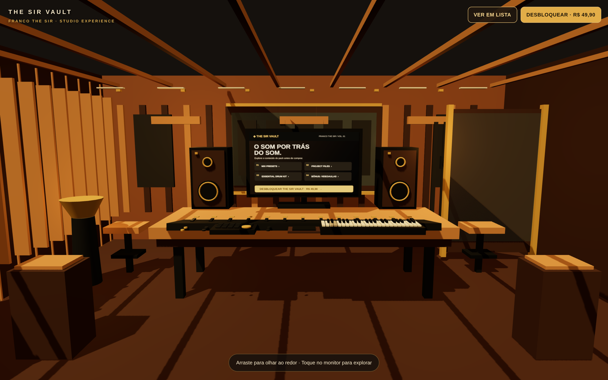
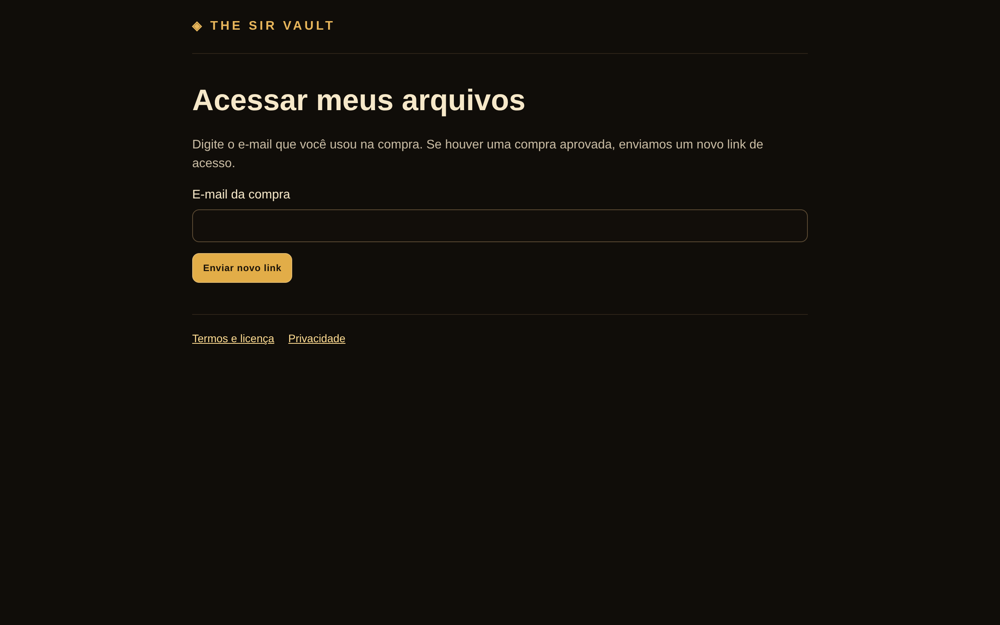
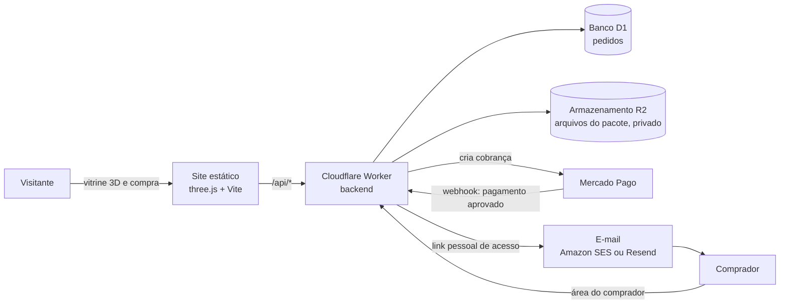

# The Sir Vault

> **Versão pública para portfólio.** O código é o mesmo do projeto em produção; foram retirados os dados pessoais do vendedor, e-mails de contato, identificadores da conta na nuvem e a documentação interna de operação e segurança. Domínio, banco e bucket aparecem como `seu-dominio.com.br`, `SEU-DATABASE-ID` e `seu-bucket-r2`. Os segredos (tokens e chaves) não ficam no código: são cadastrados direto na Cloudflare. O repositório começa com histórico novo, sem os commits do repositório privado.

Loja de um produto digital com **vitrine 3D interativa** e **entrega automática após o pagamento**. O visitante entra num estúdio de música em 3D, explora o conteúdo do pacote (mix presets, project files, drum kit e videoaulas) na tela do monitor e compra pelo Mercado Pago. Quando o pagamento é aprovado, recebe por e-mail um link pessoal para baixar os arquivos.

Site no ar: [thesirvault.com.br](https://thesirvault.com.br)



## Destaques técnicos

- **Front-end 3D com three.js**, sem framework: cena, câmera com gestos (arrastar, pinça, roda do mouse, toque) e um monitor interativo. Em aparelhos sem suporte a 3D, o site mostra uma versão em lista gerada no build.
- **Backend serverless** num Cloudflare Worker, organizado em camadas: rotas (só HTTP), casos de uso (regras do negócio), repositórios (SQL) e serviços externos, ligados num único arquivo de dependências.
- **Pagamento com Mercado Pago Checkout Pro** (Pix, cartão, boleto): webhook conferido por assinatura HMAC e pela API do Mercado Pago; o preço vem só do servidor.
- **Entrega segura dos arquivos**: bucket R2 privado, links de download assinados (HMAC) que valem 1 hora, e link de acesso pessoal de alta entropia.
- **Banco Cloudflare D1** (SQLite) com migrações versionadas e limpeza diária agendada (cron) para guardar só o necessário (LGPD).
- **Segurança desde o projeto**: segredos fora do código, cabeçalhos de segurança restritivos, validação de entrada, limitador de tentativas, erros genéricos para o usuário e testes automatizados de segurança.
- **123 testes automatizados** com `node:test`, incluindo um D1 local em SQLite, rodando no CI junto com build e `npm audit`.
- **Monitoramento**: logs estruturados com e-mail mascarado e alertas por e-mail.

## Stack

JavaScript (ES modules) · three.js · Vite · Cloudflare Workers, D1 e R2 · Mercado Pago · Amazon SES ou Resend · node:test · GitHub Actions



## Arquitetura (visão geral)



O backend é organizado em camadas, cada uma com uma responsabilidade:

| Camada | O que faz |
| --- | --- |
| `rotas/` | Só traduz HTTP: lê a requisição e devolve a resposta |
| `casos-de-uso/` | Regras do negócio: criar pedido, processar pagamento, liberar acesso, gerar link de download, reenviar acesso, limpeza diária |
| `repositorios/` | Acesso ao banco, sempre com SQL parametrizado |
| `servicos/` | Integrações externas: pagamento, e-mail, armazenamento, links assinados, alertas |
| `dependencias.js` | Único ponto que liga as peças reais; nos testes, entram versões falsas |

O fluxo de compra: o visitante informa nome e e-mail, o Worker cria o pedido e a cobrança no Mercado Pago. Quando o pagamento é aprovado, o Mercado Pago avisa o Worker, que confere o pagamento e envia por e-mail um link pessoal. Pela área do comprador, o cliente gera links de download temporários para os arquivos.

## Como funciona

1. O visitante explora o estúdio 3D (ou a versão em lista, em aparelhos sem 3D) e clica em **Desbloquear**.
2. Informa nome e e-mail, e é levado ao **Mercado Pago** (Pix, cartão ou boleto).
3. Quando o pagamento é aprovado, o Mercado Pago avisa o nosso backend (um Worker da Cloudflare), que envia por e-mail um **link pessoal e vitalício**.
4. Na **página do comprador**, o cliente baixa os arquivos (links de 1 hora) e as videoaulas bônus.

## Rodar no computador

Requer Node 22. Não precisa de conta em nenhum serviço para rodar o site e os testes.

```bash
npm ci
npm run dev           # só o site, em http://localhost:5173 (sem a API)
npm test              # testes do backend, do banco (SQL real) e de segurança
npm run build         # gera a pasta dist/
```

Para rodar site e API juntos, do jeito que rodam na Cloudflare:

```bash
cp .dev.vars.example .dev.vars    # preencha com credenciais de TESTE
npm run banco:migrar:local
npm run dev:worker                # http://localhost:8787
```

Publicar: `npm run publicar` (roda testes e auditoria antes). Antes, preencha em `wrangler.jsonc` o seu domínio, o ID do banco D1 e o nome do bucket R2, e cadastre os segredos com `npx wrangler secret put`.

## Onde fica cada coisa

```
index.html, comprador.html, termos.html, privacidade.html   páginas do site
public/_headers             cabeçalhos de segurança (CSP, HSTS...) dos arquivos estáticos
src/                        tudo o que roda no navegador
  conteudo/pacote.js          textos, itens e preço do pacote (fonte única)
  vitrine.js                  entrada da vitrine: decide entre 3D e versão em lista
  cena/                       estúdio 3D (three.js)
    iniciar-estudio.js          liga renderizador, cena e laço de animação
    estudio.js                  sala, móveis, luzes
    monitor.js                  tela interativa do monitor
    camera.js                   gestos: arrastar, pinça, roda do mouse, toque
    formas.js, materiais.js     peças básicas
  interface/                  janela de compra, avisos, detecção de 3D
  comprador/pagina.js         página do comprador
  comum/api.js                chamadas ao backend
  estilos/                    CSS
servidor/                   o Worker da Cloudflare (backend)
  index.js                    entrada: roteia /api/* e roda a limpeza diária
  rotas/                      uma rota por arquivo (só traduz HTTP)
  casos-de-uso/               regras do negócio (pedido, pagamento, acesso, download, reenvio, limpeza)
  repositorios/               acesso ao banco D1 (SQL com parâmetros)
  servicos/                   Mercado Pago, Amazon SES ou Resend, R2, links assinados, limitador, alertas por e-mail
  dependencias.js             liga tudo (único lugar que conhece as peças reais)
  entregaveis.js              arquivos do R2 que o comprador recebe
  seguranca.js, validacao.js, http.js, erros.js, registro.js, config.js
banco/migracoes/            estrutura do banco D1, versionada
wrangler.jsonc              configuração do Worker (banco, bucket, domínio, cron)
tests/                      testes com node:test (inclui um D1 local em SQLite)
docs/prints/                imagens deste README
```

## Para mudar o conteúdo

- **Textos, itens ou preço:** `src/conteudo/pacote.js` (monitor 3D, versão em lista e cobrança usam este arquivo).
- **Arquivos para download:** suba no seu bucket R2 e ajuste `servidor/entregaveis.js`.
